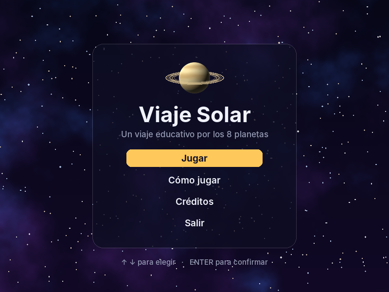
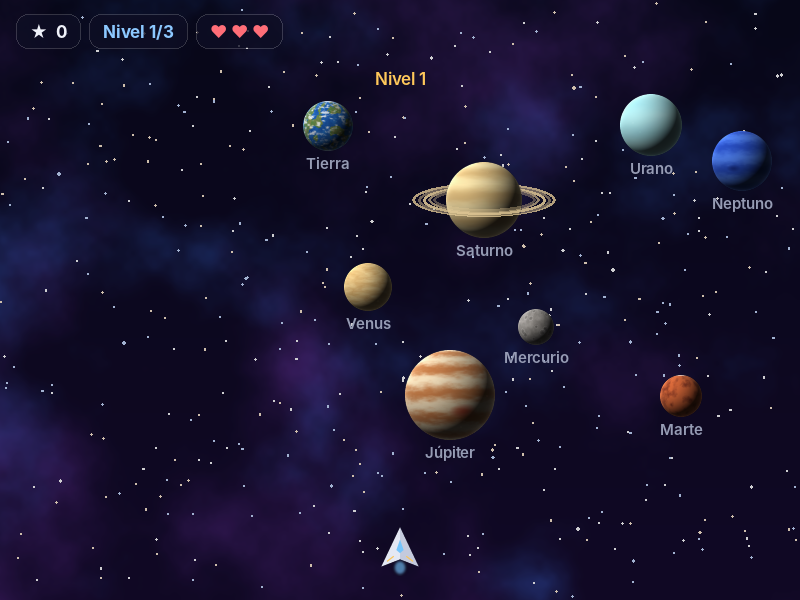
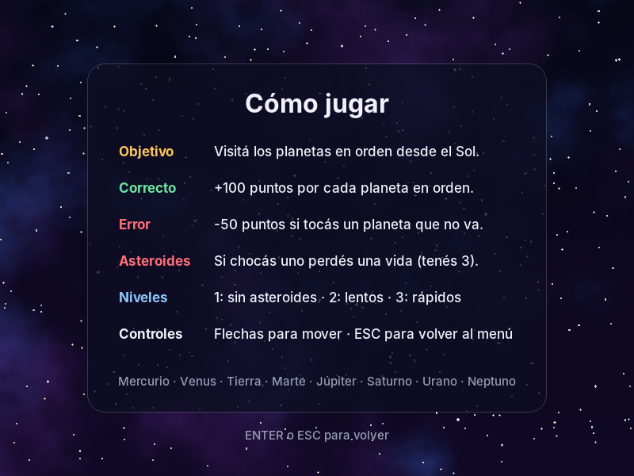

# 🚀 Viaje Solar (Solar Journey)

An educational game built with Python and Pygame where players pilot a spaceship to visit the 8 planets of the Solar System in order from the Sun. Created as a university integrative project for UAI (Universidad Abierta Interamericana), 2026.



## 📖 About the Game

**Viaje Solar** is an educational exploration and dodge game where the player controls a spaceship and must visit all 8 planets of the Solar System in the correct order: **Mercury, Venus, Earth, Mars, Jupiter, Saturn, Uranus, and Neptune**. 

The game features:
- **3 progressive difficulty levels** with increasing challenge
- **Educational focus**: planets are proportionally sized and show recognizable features (Saturn's rings, Jupiter's Great Red Spot, polar ice caps on Earth and Mars)
- **Dynamic gameplay**: planets spawn in random positions each level, forcing players to memorize the order, not locations
- **Score system** with visual and audio feedback
- **Lives system** with invulnerability frames
- **Background music and sound effects**



## 🎮 How to Play

### Objective
Visit all 8 planets in order from closest to farthest from the Sun, across 3 levels of increasing difficulty.

### Controls
- **Arrow Keys**: Move the spaceship
- **Arrow Keys**: Navigate menu options
- **ENTER**: Confirm selection / Start game
- **ESC**: Return to menu

### Rules & Scoring

| Action | Result |
|--------|--------|
| Touch the correct planet | +100 points, green glow effect, success sound |
| Touch wrong planet | -50 points, ship bounces back, warning sound |
| Complete a level (8 planets) | +200 bonus points |
| Collide with asteroid | -1 life (start with 3 lives), screen shake, brief invulnerability |
| Run out of lives | Game Over |

### Difficulty Progression

| Level | Asteroids | Asteroid Speed | Purpose |
|-------|-----------|----------------|---------|
| 1 | 0 | N/A | Learn the planet order without pressure |
| 2 | 4 | Slow | Recall the order while dodging obstacles |
| 3 | 7 | Fast | Apply knowledge under increased pressure |

Lives and score carry over between levels, so mistakes compound!



## 🚀 Getting Started

### Prerequisites
- Python 3.7 or higher
- pip (Python package installer)

### Installation

1. Clone this repository:
```bash
git clone <repository-url>
cd viaje-solar
```

2. Install dependencies:
```bash
pip install -r requirements.txt
```

### Running the Game

```bash
python Main.py
```

Or on systems where Python 3 is not the default:
```bash
python3 Main.py
```

## 📁 Project Structure

```
ViajeSolar/
├── Main.py                 # Entry point - launches the game
├── Creditos.py            # Credits and resource information
├── requirements.txt       # Python dependencies
├── lib/                   # Game modules
│   ├── __init__.py
│   ├── Core.py           # Main game classes (Ship, Planet, Asteroid, Game)
│   ├── Var.py            # Global variables and configuration
│   ├── Color.py          # Color palette
│   ├── Interfaz.py       # UI drawing functions
│   └── Sonido.py         # Sound manager class
├── Sprite/               # Game graphics
│   ├── Personaje/        # Player spaceship sprite
│   ├── Obstaculos/       # 8 planet sprites
│   ├── Enemigos/         # Asteroid sprites
│   └── Fondos/           # Background image
├── Sonidos/              # Audio files
│   ├── musica_fondo.mp3  # Background music
│   ├── acierto.mp3       # Success sound
│   └── error.mp3         # Error sound
├── Fuentes/              # Fonts
│   └── Inter-*.otf       # Inter font family (OFL licensed)
└── docs/                 # Documentation
    ├── presentacion.pptx      # Project presentation
    ├── documentacion.pdf      # Full project documentation (Spanish)
    └── screenshots/           # Game screenshots
```

## 🛠️ Technologies & Implementation

### Built With
- **Python 3.12**
- **Pygame 2.5+** - Game development library

### Technical Highlights

The game demonstrates fundamental game development concepts learned in Programming II:

- **Object-Oriented Programming**: Classes for `Nave` (Ship), `Planeta` (Planet), `Asteroide` (Asteroid), `TextoFlotante` (Floating Text), and `Juego` (Game)
- **Inheritance**: Game entities inherit from `pygame.sprite.Sprite`
- **Game Loop**: 60 FPS loop handling events, updates, and rendering
- **Collision Detection**: Circular collision detection using `pygame.sprite.spritecollide()`
- **State Management**: Menu, instructions, credits, playing, level complete, game over, victory
- **Sprite Groups**: Efficient batch updates with `pygame.sprite.Group`
- **Modular Architecture**: 
  - Configuration separated in `Var.py` (makes it easy to adjust difficulty or add levels)
  - Colors centralized in `Color.py`
  - UI functions in `Interfaz.py`
  - Sound management in `Sonido.py`

### Visual & Audio Effects
- **Success feedback**: Green glow around planet, "+100" floating text, score turns green, bell sound
- **Error feedback**: Ship bounces back with physics, red ripple on planet, amber score, warning sound
- **Collision feedback**: Screen shake, red flash overlay, ship flickers during invulnerability
- **Animated elements**: Floating score text, trailing effect during bounce, Saturn's ring system

## 🎓 Educational Purpose

This game was developed as **TP Integrador 2** for the Programming II course at Universidad Abierta Interamericana (UAI), 2026.

### Learning Objectives
1. **Astronomy**: Learn and memorize the order of the Solar System's planets from the Sun
2. **Visual Recognition**: Planets are proportionally sized and feature realistic characteristics
3. **Active Learning**: Knowledge is reinforced through repetition with progressive difficulty
4. **Problem Solving**: Plan routes while avoiding obstacles

### Programming Concepts Demonstrated
- Input/Output handling (keyboard, screen, audio)
- Game development with Pygame
- Classes and objects
- Inheritance
- Main game loop architecture
- Collision detection algorithms
- State machines
- Modular code organization

## 📚 Documentation

Full project documentation is available in Spanish:
- **[documentacion.pdf](docs/documentacion.pdf)** - Complete technical documentation including design decisions, game mechanics, code architecture, and reflections
- **[presentacion.pptx](docs/presentacion.pptx)** - Project presentation slides

A gameplay video was recorded but is not included in this repository due to file size.

## 🎨 Assets & Credits

All assets were generated specifically for this project:

- **Graphics**: AI-generated planet sprites with realistic features, spaceship, asteroids, and space background
- **Audio**: AI-generated background music and sound effects (success bells, warning tone)
- **Typography**: [Inter font family](https://rsms.me/inter/) - SIL Open Font License
- **Game Library**: [Pygame](https://www.pygame.org/)

### AI Assistance
Claude (Anthropic) was used as a programming assistant for generating graphics and audio from mathematical formulas, implementing visual effects (screen shake, ripples, glows, particle trails, Saturn's rings), and synthesizing sounds from waveforms. Game logic, class structure, collision detection, and main loop were designed and implemented by the developer.

## 👩‍💻 Author

**Candela Dolores Dengra**  
Full-Stack Developer  
Analista Programador - Universidad Abierta Interamericana (UAI)

---

## 📖 Versión en español

### Descripción
**Viaje Solar** es un videojuego educativo desarrollado en Python usando Pygame donde el jugador maneja una nave espacial y debe visitar los 8 planetas del Sistema Solar en orden desde el más cercano al Sol hasta el más lejano.

### Objetivo educativo
El juego enseña el orden de los planetas (Mercurio, Venus, Tierra, Marte, Júpiter, Saturno, Urano, Neptuno) mediante repetición activa. Los planetas tienen tamaños proporcionales a la realidad y características visuales reconocibles.

### Cómo jugar
- **Flechas**: Mover la nave
- **ENTER**: Confirmar
- **ESC**: Volver al menú

El jugador debe visitar los 8 planetas en orden a través de 3 niveles. Tocar el planeta correcto suma puntos, equivocarse resta puntos y rebota la nave, y chocar asteroides quita vidas.

### Instalación

```bash
pip install -r requirements.txt
python Main.py
```

### Contexto académico
Trabajo práctico integrador N°2 de la materia Programación II, Universidad Abierta Interamericana (UAI), 2026. El proyecto aplica conceptos de programación orientada a objetos, pygame, detección de colisiones, y arquitectura modular.

La documentación completa en español está disponible en [docs/documentacion.pdf](docs/documentacion.pdf).

---

## 📄 License

This is an academic project developed for educational purposes at UAI.

- **Code**: Created by Candela Dengra as coursework
- **Inter Font**: [SIL Open Font License](Fuentes/OFL.txt)
- **Pygame**: LGPL License
